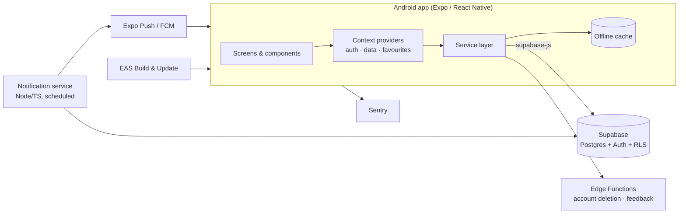

<h1 align="center">RaveVienna</h1>

<b>Discover Vienna's electronic music scene: events, DJs and venues in one app.</b>

  

> **Showcase repository.** The source code is private. This repo documents the product, the stack and the engineering behind it. Code access is available on request.

---

## About

RaveVienna is a published Android app for people who go out to electronic music events in Vienna. It brings together the city's club nights, DJs and venues (Flex, Das Werk, Grelle Forelle, U4, Celeste and more) and personalises what you see based on the genres you like. I designed, built and shipped it end to end: UI, backend, push notifications and Play Store release.

## Features

- 🎉 **Events:** browse tonight's and upcoming events with lineups, prices, genres and event status
- 🎧 **DJs & venues:** artist and venue pages with linked events
- 🗺️ **Map:** see venues and events on a custom-styled dark map
- 🔍 **Search & filters:** search across events, DJs and venues, filter by genre and date
- ❤️ **Favourites:** save events, DJs and venues; liked-event reminders
- ✨ **Personalisation:** genre-intensity preferences drive personalised event, DJ and venue ranking
- 🔔 **Push notifications:** "tonight" alerts, a weekend digest and reminders for liked events
- 🚕 **Get there:** one-tap ride options (Uber, Bolt) and directions to the venue
- 🎟️ **Tickets:** links to resale tickets via TicketSwap where available
- ➕ **Submit an event:** users can propose events for review
- 👤 **Accounts:** sign-up/login, password reset, profile with avatar, in-app account deletion
- 🌐 **English & German** UI, with an offline cache and offline banner
- 💬 **In-app feedback**

## Tech stack

| Area | Technology |
|---|---|
| App | React Native 0.81, Expo SDK 54, TypeScript, React 19 |
| Navigation | React Navigation (bottom tabs, native stack, material top tabs) |
| UI & animation | Reanimated 4, Expo Blur / Linear Gradient, React Native SVG, FlashList, Lucide icons |
| Maps | react-native-maps with a custom map style |
| Backend | Supabase (Postgres, Auth, Row Level Security, Storage, Edge Functions) |
| Push | Expo Notifications + Firebase Cloud Messaging; Node/TypeScript cron service for campaigns |
| i18n | i18next / react-i18next (EN, DE), expo-localization |
| Monitoring | Sentry |
| Delivery | EAS Build, EAS Update (over-the-air updates), GitHub Actions, Google Play |

## Architecture overview

- **Client:** screens talk to a typed service layer, never to the database directly; shared state lives in React context providers.
- **Data:** Supabase Postgres with Row Level Security policies per table, so the app only uses a public client key.
- **Server tasks:** privileged operations (account deletion, feedback mail) run in Supabase Edge Functions; notification campaigns run in a separate scheduled TypeScript service.

## Key engineering decisions & challenges

- **Personalisation without a recommender backend:** user genre-intensity scores are matched against event and DJ genres on the client and in the notification service to rank content and target pushes.
- **Smooth lists on mid-range Android:** FlashList, skeleton loaders, deferred work until idle and list stabilisation to avoid re-render jank.
- **Offline-first feel:** cached data with network-status detection, so the app opens fast and stays usable in a club basement with no signal.
- **Targeted push campaigns:** tonight, weekend-digest and liked-event reminder jobs with dedup logging, dry-run mode and per-user opt-out.
- **Security & privacy:** RLS on every table, secrets kept server-side, blocked unneeded Android permissions, and in-app account deletion to meet Google Play's data-safety rules.
- **Release engineering:** EAS build profiles, release verification scripts, minified/shrunk release builds and OTA updates.

## Screenshots

> 📸 Screenshots to be added in [`/screenshots`](screenshots/).

<!-- Example once added:

  
  
  

-->

## Source code

The source is private. If you'd like to review the code (for hiring or collaboration), get in touch and I can give temporary read access or walk you through it live.

## Author

**David Vaisman**: software engineer, Vienna

- 🌐 [vaismand.com](https://vaismand.com)
- 💼 [LinkedIn](https://www.linkedin.com/in/david-vaisman-041212129/)
- 🚀 [Upwork](https://www.upwork.com/freelancers/~0161765a02e67ee43b)
- 🐙 [GitHub](https://github.com/vaismand)
